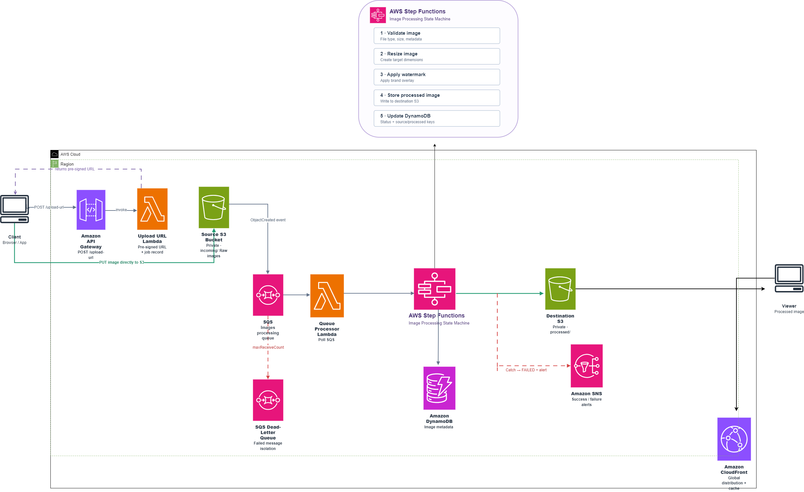

# Serverless Image Processing Pipeline


An event-driven serverless image-processing project built with AWS managed services. It separates upload requests, message buffering, workflow orchestration, image transformation, metadata storage, notifications, and private global delivery.

## Contents

- [Overview](#overview)
- [Architecture](#architecture)
- [How the workflow works](#how-the-workflow-works)
- [Repository structure](#repository-structure)
- [Configuration without hard-coded account details](#configuration-without-hard-coded-account-details)
- [Deploy the infrastructure](#deploy-the-infrastructure)
- [Test the pipeline](#test-the-pipeline)
- [Code walkthrough](#code-walkthrough)
- [Reliability and error handling](#reliability-and-error-handling)
- [Security](#security)
- [Monitoring and cost](#monitoring-and-cost)
- [Clean up](#clean-up)
- [Testing locally](#testing-locally)
- [Limitations and next steps](#limitations-and-next-steps)
- [AWS documentation](#aws-documentation)

## Overview

A client asks Amazon API Gateway for a temporary Amazon S3 pre-signed URL. The Upload URL Lambda creates a unique object key and a URL that permits an upload to the private source bucket. The client then uploads the image **directly to S3**—the image bytes do not pass through API Gateway or Lambda.

An S3 `ObjectCreated` event is sent to an SQS processing queue. The Queue Processor Lambda consumes the message and starts an AWS Step Functions execution. The workflow runs the image-processing Lambda, stores the resized result in a separate private S3 bucket, updates DynamoDB metadata, and publishes a success notification through SNS. If the image-processing task fails, a failure handler records the failed status and publishes a failure notification.

CloudFront uses Origin Access Control (OAC) to deliver processed images without making the destination bucket public. A dedicated cache policy controls TTLs and avoids forwarding cookies, headers, or query strings that this application does not need. Amazon CloudWatch collects logs and service metrics.

**Scope:** the repository includes application source files and an AWS SAM template intended to deploy the demonstrated architecture. You still need to configure unique S3 bucket names, deploy it in your account, verify the generated resources, and run the tests below. A checked-in template is not proof that a live stack has already been deployed or tested.

## Architecture

The diagram is stored in the `architecture/` directory and embedded directly below.



### End-to-end flow

```text
Client
  |  POST /upload-url
  v
API Gateway -> Upload URL Lambda -> DynamoDB (UPLOAD_URL_ISSUED)
  |                                   |
  | returns a pre-signed URL           +--> presigned PUT URL for source S3
  v
Client -- PUT image directly --> Private S3 Source Bucket
                                      |
                                      | ObjectCreated event, prefix incoming/
                                      v
                                SQS Processing Queue ----> SQS DLQ
                                      |
                                      v
                                Queue Processor Lambda
                                      |
                                      | StartExecution (stable name)
                                      v
                                AWS Step Functions
                                      |
                                      v
                                Image Processing Lambda
                                  |      |       |
                                  |      |       +--> DynamoDB: COMPLETED
                                  |      +----------> S3 Destination: processed/
                                  |
                                  +--> validate and resize with Pillow

Step Functions success -> SNS success notification
Step Functions failure -> Failure Handler Lambda -> DynamoDB: FAILED + SNS notification

Viewer -> CloudFront -> OAC-authorized private S3 Destination Bucket
Logs and metrics -> CloudWatch
Permissions -> IAM roles and resource policies
```

### Important architecture distinctions

- **Pre-signed URL:** grants temporary access to one intended S3 operation. The image bytes travel from the client directly to S3.
- **SQS:** buffers object-created events and separates upload volume from processing capacity.
- **Queue Processor Lambda:** consumes SQS messages and starts workflows; it does not resize images.
- **Step Functions:** orchestrates the steps; it is not itself an image-processing engine.
- **Image Processing Lambda:** validates the downloaded image, resizes it with Pillow, stores the processed object, and updates job metadata.
- **SQS DLQ versus workflow failure:** the DLQ captures messages that repeatedly fail in the SQS consumer path. If the Queue Processor starts Step Functions successfully and acknowledges the message, a later workflow task failure is handled by Step Functions Retry/Catch and the failure handler—not automatically by that SQS DLQ.
- **CloudFront OAC:** allows CloudFront to access the destination bucket while keeping direct public bucket access blocked.

## How the workflow works

### 1. Request an upload URL

Send a JSON body to the API endpoint with the original filename and media type:

```json
{
  "original_filename": "holiday-photo.jpg",
  "content_type": "image/jpeg"
}
```

The API returns an `image_id`, a temporary `upload_url`, the required `Content-Type` header, and the URL expiry. The service accepts JPEG, PNG, and WEBP media types in this starter implementation.

### 2. Upload directly to S3

Use HTTP `PUT` to the returned URL, including the exact `Content-Type` header returned by the API. The source bucket remains private. The key is generated server-side under `incoming/`, rather than trusting a user-supplied path.

The configured maximum image size is checked by the processing Lambda before it downloads the object. **A pre-signed PUT URL does not impose a maximum-size range by itself**, so an oversized file may reach S3 before processing rejects it. For strict upload-time size enforcement, consider a pre-signed POST policy with a `content-length-range` condition or a separate upload control.

### 3. S3 sends the event to SQS

The bucket notification watches object-created events under `incoming/`. The SQS queue buffers messages and uses a redrive policy to move messages to the DLQ after repeated queue-consumer failures.

### 4. Queue Processor starts Step Functions

The Queue Processor parses the S3 event, URL-decodes the object key, and builds a workflow input containing `bucket`, `key`, and `imageId`. It generates a stable Step Functions execution name from the bucket and key to reduce duplicate executions when S3/SQS redelivers the same event.

### 5. Process, store, and update metadata

The image-processing Lambda checks the source bucket and object prefix, checks the object size, downloads the original image into the Lambda temporary directory, validates that Pillow can decode an allowed image format, resizes it while preserving aspect ratio, uploads the result to `processed/` in the destination bucket, and updates DynamoDB.

Example metadata item:

```json
{
  "ImageId": "incoming/unique-object-key.jpg",
  "OriginalFilename": "holiday-photo.jpg",
  "ContentType": "image/jpeg",
  "Status": "COMPLETED",
  "ProcessedKey": "processed/unique-object-key-processed.jpg",
  "ProcessedBucket": "value-from-deployment-configuration",
  "ProcessedContentType": "image/jpeg",
  "CreatedAt": "ISO-8601 timestamp",
  "UpdatedAt": "ISO-8601 timestamp"
}
```

Status values used by the application include `UPLOAD_URL_ISSUED`, `PROCESSING`, `COMPLETED`, and `FAILED`.

### 6. Notify and deliver

After successful processing, Step Functions publishes a success message to SNS. If processing fails, the workflow invokes the Failure Handler Lambda, which updates DynamoDB to `FAILED` and publishes a failure notification. If you provide an email subscription during deployment, SNS sends a subscription confirmation email; confirm the subscription before expecting email notifications.

CloudFront delivers objects from the private destination bucket through OAC. A viewer URL is composed from the deployed CloudFront domain and the processed object key, for example `https://CLOUDFRONT_DOMAIN/processed/OBJECT_KEY.jpg`. Replace the example placeholders with the outputs from your stack.

## Repository structure

```text
aws-serverless-image-processing-pipeline/
├── .github/
│   └── workflows/
│       └── ci.yml
├── .gitignore
├── LICENSE
├── README.md
├── template.yaml
├── samconfig.toml.example
├── requirements-dev.txt
├── architecture/
│   └── architecture-diagram.png
├── statemachine/
│   └── image-processing.asl.json
├── src/
│   ├── upload_url/
│   │   └── app.py
│   ├── queue_processor/
│   │   └── app.py
│   ├── process_image/
│   │   ├── app.py
│   │   └── requirements.txt
│   └── failure_handler/
│       └── app.py
├── tests/
│   └── test_helpers.py
└── screenshots/
    └── README.md
```

Each Lambda has its own folder and handler. The infrastructure, Step Functions definition, tests, architecture image, and deployment example are stored separately so you can maintain and explain them independently.

## Configuration without hard-coded account details

No account ID, fixed Lambda ARN, or personal bucket name should be embedded in the Python handlers.

| Setting | Where it comes from | Why |
|---|---|---|
| AWS Region and account | Current deployment / CloudFormation | The same template can be deployed to different accounts and Regions |
| Source S3 bucket name | `SourceBucketName` parameter | S3 bucket names must be globally unique |
| Destination S3 bucket name | `DestinationBucketName` parameter | Keeps processed files isolated and private |
| DynamoDB table name | `!Ref ImageMetadataTable` | CloudFormation provides the generated resource name |
| Step Functions ARN | `!Ref ImageProcessingStateMachine` | The Queue Processor receives the deployed state-machine ARN as an environment variable |
| Lambda and SNS ARNs | `DefinitionSubstitutions` and CloudFormation references | Step Functions uses resource ARNs generated by the same deployment |
| URL expiry | `UploadUrlExpirationSeconds` parameter | Can be tuned without editing application code |
| Maximum image size and dimensions | `MaxImageBytes` and `MaxImageDimension` parameters | Lets the deployment adjust processing limits |
| Browser origin | `AllowedOrigin` parameter | Configure the actual frontend domain instead of leaving a wildcard in production |
| Queue timeout, visibility timeout, retention and DLQ threshold | Queue-related template parameters | Tune buffering and retries; keep visibility timeout at least six times the Queue Processor timeout |
| Image-processing timeout, memory and temporary storage | `ImageProcessorTimeoutSeconds`, `ImageProcessorMemoryMB`, `ImageProcessorEphemeralStorageMB` | Tune image workloads without editing Python code |
| CloudFront price class and cache TTLs | CloudFront template parameters | Balance edge coverage, caching and cost |
| SQS receive-count threshold | `MaxQueueReceiveCount` (default 5) | AWS recommends a threshold of at least five receives before a message is moved to a DLQ |
| Optional email | `NotificationEmail` parameter | Can enable one email subscription without editing the template |

The value from an example like `my-destination-images-bucket-859816906510-us-east-1-an` must **not** be copied as-is. It includes an account-specific-looking suffix and may not exist in your account. Supply your own globally unique lowercase bucket names during deployment. Do not hard-code account IDs or Region strings into handlers.

## Deploy the infrastructure

### Prerequisites

Install and configure:

- AWS CLI with credentials for the target account.
- AWS SAM CLI.
- Python 3.12.
- Docker Desktop (or Docker Engine) running, so Pillow can be built in a Lambda-compatible Linux environment.
- A deployment role/user allowed to create the resources in `template.yaml`.

Review the current AWS service pricing before deploying. This template creates a CloudFront distribution and enables DynamoDB point-in-time recovery, in addition to the Lambda, S3, SQS, Step Functions, SNS, API Gateway, and CloudWatch resources.

### 1. Validate and build

From the repository root:

```bash
sam validate --lint
sam build --use-container
```

The SAM build packages the Pillow dependency from `src/process_image/requirements.txt`. The `--use-container` option builds dependencies in a Lambda-compatible container, which avoids accidentally packaging a Windows/macOS Pillow binary for Lambda.

### 2. Deploy

Run:

```bash
sam deploy --guided
```

Use a lowercase stack name and provide two different, globally unique bucket names when prompted:

- `SourceBucketName`: private source bucket for uploaded originals.
- `DestinationBucketName`: private destination bucket for processed images.

Set `AllowedOrigin` to the real frontend origin if there is one. For a learning test without a browser frontend, `*` can be used temporarily, but it is not the recommended production configuration. Set `NotificationEmail` to an email address to create an optional SNS subscription, or leave it blank.

You can also copy `samconfig.toml.example` to `samconfig.toml`, replace the example values, and run `sam deploy`. Do not commit your personal deployment configuration if it contains account-specific information.

### 3. Save the stack outputs

After deployment, capture the outputs printed by CloudFormation. The main ones are:

- `UploadUrlEndpoint`
- `SourceBucketName`
- `DestinationBucketName`
- `ImageMetadataTableName`
- `NotificationTopicArn`
- `CloudFrontDomainName`
- Queue and DLQ URLs

CloudFormation-generated ARNs are wired into the template automatically; you do not need to paste them into the source files.

## Test the pipeline

### 1. Request a pre-signed URL

Replace the endpoint with your `UploadUrlEndpoint` output:

```bash
curl -sS -X POST "YOUR_UPLOAD_URL_ENDPOINT" \
  -H "Content-Type: application/json" \
  -d '{"original_filename":"sample.jpg","content_type":"image/jpeg"}' \
  -o response.json
cat response.json
```

The response contains `upload_url` and `image_id`.

### 2. Upload an image

Save the response as `response.json` and use a local JPEG file named `sample.jpg`:

```bash
curl -X PUT "$(jq -r .upload_url response.json)" \
  -H "Content-Type: image/jpeg" \
  --data-binary "@sample.jpg"
```


On Windows PowerShell, the same request/upload flow can be run without `curl`/ `jq` parsing:

```powershell
$endpoint = "YOUR_UPLOAD_URL_ENDPOINT"
$body = @{ original_filename = "sample.jpg"; content_type = "image/jpeg" } | ConvertTo-Json
$response = Invoke-RestMethod -Method Post -Uri $endpoint -ContentType "application/json" -Body $body
Invoke-WebRequest -Method Put -Uri $response.upload_url -ContentType "image/jpeg" -InFile ".\sample.jpg"
```

The `Content-Type` must match the value used to sign the URL. Do not share the returned pre-signed URL; it grants temporary upload access.

### 3. Verify the result

In the AWS console or using the AWS CLI:

- Confirm the original appears under `incoming/` in the source bucket.
- Confirm the processing queue receives the event.
- Open Step Functions and check the execution status.
- Confirm a processed object appears under `processed/` in the destination bucket.
- Check the DynamoDB item for `COMPLETED` or `FAILED`.
- Check the SNS topic/subscription for the notification.
- Open the processed object through the CloudFront domain.

### Validation checklist

- [ ] API returns a pre-signed URL for an allowed media type.
- [ ] The upload succeeds when the required `Content-Type` is included.
- [ ] An S3 event is delivered to SQS.
- [ ] The Queue Processor starts the state-machine execution.
- [ ] The processing Lambda validates and resizes the image.
- [ ] The processed file is stored in the destination bucket.
- [ ] DynamoDB records the output key and final status.
- [ ] SNS publishes the success or failure message.
- [ ] CloudFront can read the processed object without making the destination bucket public.
- [ ] Repeated queue messages do not start duplicate concurrent executions.
- [ ] A deliberately invalid/unsupported image follows the state-machine failure path.

## Code walkthrough

| File | Responsibility |
|---|---|
| `src/upload_url/app.py` | Validates the upload request, creates a unique incoming key, writes the initial DynamoDB item, and generates a short-lived S3 pre-signed URL |
| `src/queue_processor/app.py` | Parses S3 event messages arriving through SQS and starts a stable-named Step Functions execution |
| `src/process_image/app.py` | Checks size and input location, decodes and resizes the image using Pillow, uploads the output, and updates DynamoDB |
| `src/failure_handler/app.py` | Marks the job as failed and publishes a failure notification |
| `statemachine/image-processing.asl.json` | Defines processing, retries, success notification, and the workflow failure path |
| `template.yaml` | Creates the S3 buckets, queue/DLQ, IAM permissions, Lambda functions, state machine, table, topic, API Gateway, and CloudFront distribution |
| `tests/test_helpers.py` | Tests request validation, S3 event parsing, and stable workflow execution-name behavior |
| `architecture/architecture-diagram.png` | Visual overview of the end-to-end design |

## Reliability and error handling

### Queue failures

If the Queue Processor cannot start a workflow or parse a message, it reports that SQS item as failed. SQS can retry it and eventually move it to the configured DLQ according to the redrive policy. Batch size is set to one to keep the failure boundary simple for this learning project.

### Workflow failures

When the processing Lambda fails, Step Functions retries selected transient errors. Its Catch path invokes the Failure Handler, which updates the job status and publishes an SNS failure message. This is separate from the SQS DLQ because the message may already have been acknowledged after the workflow started.

### Duplicate events

S3 notifications and SQS use at-least-once delivery. The Queue Processor derives the execution name deterministically from the source bucket and key and treats `ExecutionAlreadyExists` as a duplicate event. A new upload receives a new random key. For a more advanced production system, add explicit conditional state transitions and define a controlled reprocessing strategy for previously failed keys.

## Security

- Both S3 buckets have Block Public Access enabled and server-side encryption.
- The destination bucket policy allows read access only to the configured CloudFront distribution through OAC.
- Each Lambda function has a dedicated IAM role with only its required S3, DynamoDB, SQS, Step Functions, or SNS actions.
- Pre-signed URLs have a short configurable expiry and are scoped to a unique key and content type.
- The source event notification only watches the `incoming/` prefix, and the processor rejects objects outside that prefix.
- Uploaded content is untrusted; the processor validates the actual file format using Pillow and checks object size.
- The API demo does not include user authentication or rate limiting. For a public production endpoint, add authentication (for example, Amazon Cognito or a suitable authorizer), request throttling, abuse protection, and an explicit maximum upload policy.
- Never commit AWS credentials, real secrets, unredacted logs, or full pre-signed URLs.

## Monitoring and cost

Use CloudWatch metrics and logs to investigate Lambda errors/duration, SQS queue depth and age, DLQ messages, failed Step Functions executions, and CloudFront request/error behavior. Consider adding alarms for sustained failures, old messages, and any non-empty DLQ.

This design is serverless, not automatically free. Requests and usage may incur charges for API Gateway, Lambda, Step Functions state transitions, SQS, S3 storage/requests, DynamoDB, SNS, CloudWatch logs, and CloudFront data transfer. DynamoDB point-in-time recovery is enabled in the template and can also incur charges. Check current pricing before deploying and use a small test workload.

## Clean up

S3 buckets generally cannot be deleted while they contain objects. Before deleting the stack, remove test objects from both buckets using the bucket names from the CloudFormation outputs:

```bash
aws s3 rm "s3://YOUR_SOURCE_BUCKET_NAME" --recursive
aws s3 rm "s3://YOUR_DESTINATION_BUCKET_NAME" --recursive
sam delete --stack-name YOUR_STACK_NAME
```

Replace the placeholders with your own output values. Review the resources in the stack before deletion, especially if you reused any bucket or table outside this project.

## Testing locally

Install the test dependency and run the unit tests:

```bash
python -m venv .venv
# Windows PowerShell:
.venv\Scripts\Activate.ps1
# macOS/Linux:
# source .venv/bin/activate
pip install -r requirements-dev.txt
pytest -q
```

The tests use dummy AWS credentials to avoid accessing your account. They exercise pure validation/parsing helpers; they do not replace an integration test against a deployed AWS stack. GitHub Actions also runs the unit tests, `sam validate --lint`, and `sam build --use-container` on pushes and pull requests.

## Limitations and next steps

- Upload size is checked by the processor after the S3 upload. Use a pre-signed POST policy or another upload control if S3 must reject oversized files before storing them.
- The demo endpoint has no user authentication, request authorization, or application-level rate limiting.
- Image transformation currently resizes images; it does not apply a watermark.
- CloudWatch alarms and dashboards can be added for production operations.
- Add CI/CD and automated integration tests before using the pipeline for a real workload.
- Consider lifecycle policies for original uploads and processed objects based on retention needs.

## AWS documentation

- [AWS SAM documentation](https://docs.aws.amazon.com/serverless-application-model/latest/developerguide/what-is-sam.html)
- [Amazon S3 pre-signed URL uploads](https://docs.aws.amazon.com/AmazonS3/latest/userguide/PresignedUrlUploadObject.html)
- [Amazon S3 event notifications](https://docs.aws.amazon.com/AmazonS3/latest/userguide/EventNotifications.html)
- [Using AWS Lambda with Amazon SQS](https://docs.aws.amazon.com/lambda/latest/dg/with-sqs.html)
- [AWS Step Functions error handling](https://docs.aws.amazon.com/step-functions/latest/dg/concepts-error-handling.html)
- [Restrict access to an S3 origin using CloudFront OAC](https://docs.aws.amazon.com/AmazonCloudFront/latest/DeveloperGuide/private-content-restricting-access-to-s3.html)
- [CloudFront cache policies](https://docs.aws.amazon.com/AmazonCloudFront/latest/DeveloperGuide/controlling-the-cache-key.html)
- [Amazon DynamoDB UpdateItem](https://docs.aws.amazon.com/amazondynamodb/latest/APIReference/API_UpdateItem.html)
- [AWS Lambda environment variables](https://docs.aws.amazon.com/lambda/latest/dg/configuration-envvars.html)

## Core architecture pattern

```text
Upload -> Event -> Queue -> Orchestrate -> Process -> Store -> Notify -> Deliver
```
