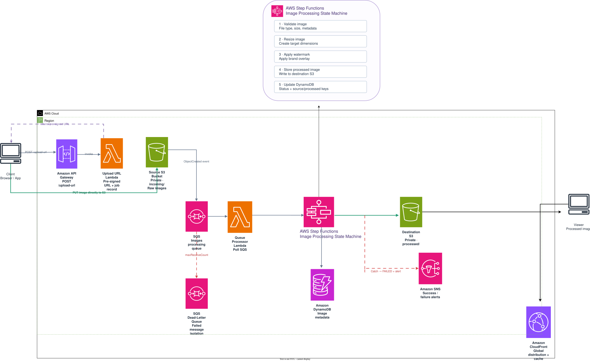

# Serverless Image Processing Pipeline

> **Event-driven, resilient, serverless image-processing architecture built with AWS managed services.**


---

## Overview

This project describes a serverless image-processing pipeline on AWS.

A client requests a temporary **S3 pre-signed URL** through Amazon API Gateway and AWS Lambda, then uploads the original image directly to a private Amazon S3 source bucket. S3 sends an object-created event to an Amazon SQS processing queue, which buffers work and separates uploads from processing.

A queue-processing Lambda starts an AWS Step Functions workflow. The workflow validates the image, resizes it, applies a watermark, stores the processed image in a separate S3 destination bucket, updates metadata in Amazon DynamoDB, and sends a notification through Amazon SNS. Amazon CloudFront delivers processed images to viewers.

The architecture also includes an SQS Dead-Letter Queue (DLQ) for messages that repeatedly fail in the queue-processing path, plus CloudWatch for logs, metrics, and alarms.

---

## Architecture



### Architecture Flow

```text
Client
  |
  | Request upload URL
  v
API Gateway
  |
  v
Upload URL Lambda
  |
  | Return pre-signed URL through API Gateway
  v
Client
  |
  | PUT image using the pre-signed URL
  v
S3 Source Bucket
  |
  | ObjectCreated event
  v
SQS Processing Queue
  |
  v
Lambda Queue Processor
  |
  | Start workflow
  v
Step Functions
  |
  +--> Validate Image
  |
  +--> Resize Image
  |
  +--> Apply Watermark
  |
  +--> Store Processed Image --> S3 Destination Bucket --> CloudFront --> Viewer
  |
  +--> Update Metadata -------> DynamoDB
  |
  +--> Publish Notification --> SNS

Queue message repeatedly fails
  |
  v
SQS Dead-Letter Queue (DLQ)
```

> **Upload-flow detail:** Lambda generates the pre-signed URL; the client uses that URL to upload the image directly to S3. The image bytes do not travel through API Gateway or the upload-URL Lambda.

---

## Why This Architecture?

A synchronous application may keep a client waiting while an image is processed, and it can struggle when many uploads arrive at once.

This architecture separates **uploading** from **processing**:

```text
Upload traffic
     |
     v
Source S3
     |
     v
SQS buffer
     |
     v
Queue Processor Lambda
     |
     v
Step Functions workflow
     |
     v
Processed image + metadata + notification
```

Amazon SQS buffers incoming work so upload traffic and processing throughput can vary independently.

Benefits include:

- Loose coupling between upload and processing
- Asynchronous processing
- Buffering during traffic spikes
- Retry support and failure isolation
- Independent scaling of managed services
- Reduced time spent waiting for an upload API response
- Separate storage and access policies for original and processed images

---

## End-to-End Workflow

### 1. Request an Upload URL

The client sends a request to an Amazon API Gateway endpoint. The upload-URL Lambda creates a short-lived pre-signed URL for a specific object key and returns it through API Gateway.

**Why use a pre-signed URL?**

- The S3 bucket can remain private.
- The URL grants temporary, scoped access.
- The image bytes do not pass through API Gateway or Lambda.
- Upload handling is separated from image processing.

### 2. Upload the Image to Source S3

The client uses the pre-signed URL to upload the image directly to the source bucket.

Example object layout:

```text
source-bucket/
└── incoming/
    ├── image-001.jpg
    ├── image-002.png
    └── image-003.jpg
```

The source bucket should have S3 Block Public Access enabled.

### 3. S3 Event → SQS

After an object is created, S3 sends an event notification to the processing queue. SQS provides a durable buffer between uploads and the processing layer.

The source bucket and queue must be configured in a compatible Region, and the queue policy must permit the S3 bucket to send messages.

### 4. SQS → Queue Processor Lambda

Lambda consumes messages from SQS through an event source mapping. It extracts the source bucket and object key and starts a Step Functions execution.

This component handles queue messages and starts workflows; it is separate from the image-processing workflow itself.

### 5. Step Functions Image-Processing Workflow

Step Functions coordinates the processing stages:

1. **Validate image** — check allowed file types, size limits, and whether the image can be decoded safely.
2. **Resize image** — create the required output dimensions.
3. **Apply watermark** — add the configured watermark.
4. **Store processed image** — write the output to the destination S3 bucket.
5. **Update metadata** — record the output key and final processing status in DynamoDB.
6. **Notify subscribers** — publish a success or failure notification through SNS as appropriate.

The individual tasks can be implemented with Lambda functions or supported service integrations, depending on the final implementation.

### 6. Deliver the Processed Image

CloudFront serves the processed object from the destination S3 bucket. Configure Origin Access Control (OAC) and an appropriate bucket policy so users access the content through the distribution rather than by making the bucket public.

---

## AWS Services

| AWS service | Responsibility |
|---|---|
| **Amazon API Gateway** | Exposes the endpoint used to request an upload URL |
| **AWS Lambda — Upload URL** | Creates a short-lived S3 pre-signed URL |
| **Amazon S3 — Source bucket** | Stores original images and emits object-created events |
| **Amazon SQS — Processing queue** | Buffers upload events and decouples processing |
| **AWS Lambda — Queue processor** | Consumes SQS messages and starts Step Functions executions |
| **AWS Step Functions** | Orchestrates validation, resize, watermark, storage, metadata, and error paths |
| **Amazon S3 — Destination bucket** | Stores processed images separately from originals |
| **Amazon DynamoDB** | Stores job metadata, object keys, and processing status |
| **Amazon SNS** | Publishes processing notifications to configured subscribers |
| **Amazon CloudFront** | Caches and delivers processed images globally |
| **Amazon SQS — DLQ** | Isolates queue messages that repeatedly fail processing |
| **Amazon CloudWatch** | Collects logs and metrics and supports alarms |
| **AWS IAM** | Controls access through least-privilege roles and policies |

---

## Reliability and Failure Handling

### SQS retries and Dead-Letter Queue

If the queue-processing Lambda repeatedly fails to process a message, SQS can move the message to a configured DLQ after the redrive policy's receive-count threshold is reached.

### Step Functions retries and Catch

Failures that happen **inside the Step Functions workflow** need workflow-level error handling. Configure Retry for transient errors and Catch paths for terminal failures. A failure path should update the DynamoDB job status to `FAILED` and publish an SNS notification when appropriate.

> **Important distinction:** the SQS DLQ does not automatically capture a later Step Functions task failure if the queue-processing Lambda already started the workflow successfully and acknowledged the SQS message. These are separate failure paths.

### Idempotency

S3 notifications and SQS messages can be delivered more than once. Processing should be designed to handle duplicate events safely, for example by using a stable job identifier and conditional state updates.

### Avoid event loops

Keep original and processed images in separate buckets, or scope S3 notifications to the source prefix, so storing an output does not trigger another processing run.

---

## Security

### Amazon S3

- Keep source and destination buckets private.
- Enable S3 Block Public Access.
- Use pre-signed URLs with short expiration and only the required upload permissions.
- Use CloudFront OAC and a restrictive bucket policy for the destination bucket.
- Enable encryption at rest and apply lifecycle policies where appropriate.

### AWS IAM

Use separate, least-privilege roles for each component. For example:

```text
Upload URL Lambda
  └── Permission to generate the intended pre-signed upload request

Queue Processor Lambda
  ├── Receive/delete messages from the processing queue
  └── Start the required Step Functions execution

Workflow tasks
  ├── Read the required source object
  ├── Write the processed destination object
  ├── Update the required DynamoDB record
  └── Publish to the configured SNS topic
```

Validate file type and size, and safely decode untrusted image files before processing them.

---

## Scalability

The upload path and processing path scale independently:

```text
Client uploads
      |
      v
Source S3
      |
      v
SQS queue  <--- buffers bursts
      |
      v
Lambda consumers
      |
      v
Step Functions
      |
      v
Processed output
```

SQS helps absorb bursts, while Lambda and other managed services can scale with demand. Concurrency limits and queue batch settings should be chosen based on workload, downstream limits, and cost.

---

## Observability

Use Amazon CloudWatch to monitor errors, latency, and workload health.

| Component | Useful signals |
|---|---|
| Lambda | Invocations, errors, duration, throttles, concurrency |
| SQS | Visible messages, oldest-message age, messages sent/received, DLQ depth |
| Step Functions | Successful/failed executions and execution duration |
| DynamoDB | Throttling and read/write activity |
| CloudFront | Request volume, cache behavior, and delivery errors |

Configure alarms for sustained errors, growing queue age, DLQ messages, and failed workflow executions.

---

## Testing Checklist

### Successful processing

- [ ] API Gateway returns a valid pre-signed URL.
- [ ] The client uploads an image to the source bucket.
- [ ] S3 sends the expected event to SQS.
- [ ] The queue processor receives the message.
- [ ] A Step Functions execution starts.
- [ ] Validation and image transformations complete.
- [ ] The processed image is stored in the destination bucket.
- [ ] DynamoDB records the final status and processed object key.
- [ ] SNS publishes the configured notification.
- [ ] CloudFront can deliver the processed image.

### Failure handling

- [ ] An unsupported or invalid image follows the workflow failure path.
- [ ] Transient workflow errors use configured retries.
- [ ] Terminal workflow failures update status and can trigger an SNS alert.
- [ ] Repeated queue-processing failures reach the SQS DLQ.
- [ ] Duplicate events do not create inconsistent job state.
- [ ] Uploading a processed object does not start an unintended processing loop.

---

## Cost Considerations

The design uses managed, serverless services, but charges may apply for requests, Lambda execution, Step Functions state transitions, SQS requests, S3 storage/requests, DynamoDB activity, SNS, and CloudFront data transfer.

For development and testing:

- Use small test images and a limited number of executions.
- Monitor AWS Billing and service usage.
- Configure S3 lifecycle policies when suitable.
- Remove unused resources after testing.
- Review current AWS pricing before deployment.

Free Tier eligibility and limits can change, so verify current terms before running the project.

---

## Future Improvements

- Add authentication for upload requests.
- Implement the workflow tasks and retry/Catch policies.
- Add Terraform or AWS CloudFormation for Infrastructure as Code.
- Add automated tests and a CI/CD pipeline.
- Add CloudWatch dashboards and alarms.
- Support multiple thumbnail sizes and output formats.
- Define retention and lifecycle policies for originals and processed images.

---

## Project Status

This repository contains the architecture diagram and project documentation. It does **not** claim that the complete AWS infrastructure has been deployed or end-to-end tested. The exact resource names, IAM policies, retry thresholds, and environment-specific settings must be configured during implementation.

---

## AWS Documentation

- [AWS Architecture Icons](https://aws.amazon.com/architecture/icons/)
- [Uploading objects using pre-signed URLs](https://docs.aws.amazon.com/AmazonS3/latest/userguide/PresignedUrlUploadObject.html)
- [Amazon S3 event notifications](https://docs.aws.amazon.com/AmazonS3/latest/userguide/EventNotifications.html)
- [Using AWS Lambda with Amazon SQS](https://docs.aws.amazon.com/lambda/latest/dg/with-sqs.html)
- [AWS Step Functions error handling](https://docs.aws.amazon.com/step-functions/latest/dg/concepts-error-handling.html)
- [Restrict access to an Amazon S3 origin with CloudFront OAC](https://docs.aws.amazon.com/AmazonCloudFront/latest/DeveloperGuide/private-content-restricting-access-to-s3.html)

---

## Key Learning Outcomes

This project demonstrates the design of an event-driven, serverless system using object storage, asynchronous messaging, workflow orchestration, metadata storage, notifications, and content delivery.

Core architecture pattern:

```text
Upload → Event → Queue → Process → Store → Notify → Deliver
```
