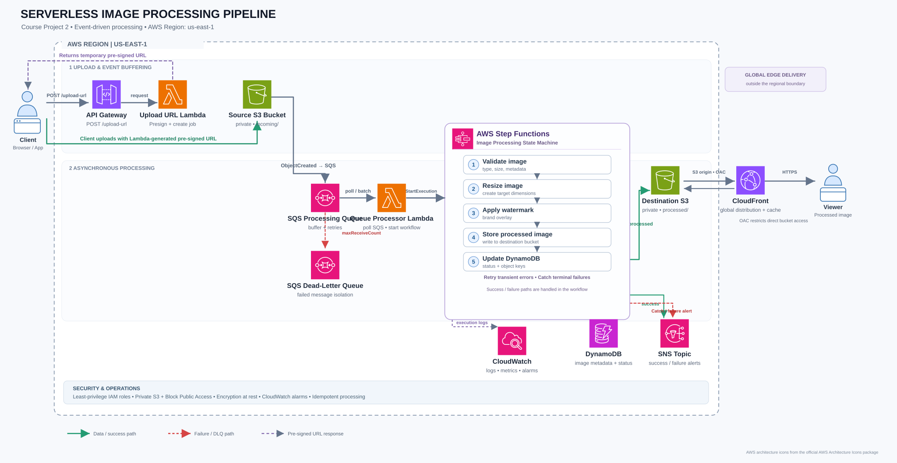

# Serverless Image Processing Pipeline on AWS

> **Course Project 2** — An event-driven, asynchronous image-processing architecture using AWS managed services.

## Architecture Overview



This diagram presents the system components and their interactions, including asynchronous processing, delivery, monitoring, and failure handling.

## What does the project do?

The project lets a client upload an original image directly to a private Amazon S3 bucket. AWS then processes the image asynchronously, stores a processed copy in a separate private bucket, records the job status, and makes the final image available through Amazon CloudFront.

The client does not need to keep an HTTP request open while the image is being processed. Amazon SQS buffers upload events, and AWS Step Functions coordinates the processing steps.

## End-to-End Workflow

1. **Request an upload URL.** The client calls an Amazon API Gateway endpoint. An AWS Lambda function creates a short-lived S3 pre-signed URL and returns it with the target object key.
2. **Upload directly to S3.** The client uses the pre-signed URL to upload the image to the private source bucket (for example, under the `incoming/` prefix). The image bytes do not pass through API Gateway or Lambda.
3. **Queue the upload event.** An S3 `ObjectCreated` notification sends a message to an Amazon SQS processing queue. The queue decouples uploads from image processing and absorbs bursts of traffic.
4. **Start the workflow.** A queue-processing Lambda consumes SQS messages and starts an AWS Step Functions execution for each image job.
5. **Process the image.** Step Functions coordinates the steps: validate file type/size, resize the image, apply a watermark, write the processed image to the destination bucket, and update the metadata record.
6. **Record status and notify.** Amazon DynamoDB stores job metadata and processing states such as `PROCESSING`, `COMPLETED`, or `FAILED`. Amazon SNS sends success/failure notifications to configured subscribers.
7. **Deliver the result.** Amazon CloudFront serves processed images from the destination S3 bucket. Origin Access Control (OAC) and the bucket policy keep the bucket private and restrict origin access to the distribution.

## AWS Services and Responsibilities

| AWS service | Responsibility |
|---|---|
| Amazon API Gateway | Exposes the upload-URL request endpoint |
| AWS Lambda — Upload URL | Creates a short-lived pre-signed upload URL |
| Amazon S3 — Source bucket | Stores original uploads; emits object-created events |
| Amazon SQS — Processing queue | Buffers jobs and enables asynchronous consumption |
| AWS Lambda — Queue processor | Reads SQS messages and starts Step Functions executions |
| AWS Step Functions | Orchestrates validation, resize, watermark, storage, metadata, and error paths |
| Amazon S3 — Destination bucket | Stores processed images separately from original uploads |
| Amazon DynamoDB | Stores image/job status and source/processed object keys |
| Amazon SNS | Publishes processing success/failure notifications |
| Amazon CloudFront | Caches and delivers processed images globally |
| Amazon CloudWatch | Collects logs/metrics and supports alarms for operational visibility |
| AWS IAM | Provides least-privilege execution roles for each component |

## Why this design?

A synchronous image processor can make the client wait and can struggle when uploads arrive in bursts. This design separates the upload path from the processing path:

```text
Client ── pre-signed PUT ──> Source S3 ── event ──> SQS
                                                   │
                                                   ▼
                                         Queue Processor Lambda
                                                   │
                                                   ▼
                                            Step Functions
                                                   │
                               ┌───────────────────┼─────────────────┐
                               ▼                   ▼                 ▼
                         Destination S3        DynamoDB             SNS
                               │
                               ▼
                           CloudFront
                               │
                               ▼
                             Client
```

The queue acts as a buffer. Upload speed and processing speed can vary independently, and the serverless services scale according to incoming work.

## Reliability and Failure Handling

- **SQS retries and DLQ:** failed queue-processor invocations can be retried and then moved to a dead-letter queue after the configured receive-count threshold. The S3 bucket and SQS queue must be in the same Region, and the queue policy must allow the source bucket to send notifications.
- **Workflow retries and Catch:** Step Functions should retry transient task failures and use a Catch path for terminal failures. The failure path marks the DynamoDB job as `FAILED` and publishes an SNS alert.
- **Important distinction:** the SQS DLQ does **not** automatically capture a later Step Functions task failure after the queue processor successfully starts the workflow and returns successfully. That is why workflow-level retries and a separate Catch/failure path are shown.
- **Idempotency:** S3 notifications and SQS messages may be delivered more than once. Processing should safely handle duplicate events (for example, by using a stable job ID/object key and conditional status transitions).
- **Avoid event loops:** keep original uploads and processed outputs in separate buckets (or use carefully scoped notification prefixes) so a processed object does not trigger another processing run.

## Security and Operations

- Keep both S3 buckets private and enable S3 Block Public Access.
- Use short-lived pre-signed URLs with the minimum required operation, object key/prefix, and expiration.
- Give each Lambda function and the Step Functions state machine its own least-privilege IAM permissions.
- Use CloudFront Origin Access Control (OAC) with a bucket policy scoped to the intended distribution for the destination bucket.
- Enable encryption at rest, configure retention/lifecycle policies as needed, and use CloudWatch logs, metrics, and alarms.
- Apply file-type/size validation and safe image decoding before processing untrusted uploads.

## Project Status

This repository currently contains the architecture diagram and documentation. It does **not** claim that the AWS resources have been deployed or end-to-end tested. Resource names, queue policies, IAM policies, retry limits, and environment-specific configuration must be set during implementation.

## AWS Documentation

- [Official AWS Architecture Icons](https://aws.amazon.com/architecture/icons/)
- [Amazon S3 event notifications](https://docs.aws.amazon.com/AmazonS3/latest/userguide/EventNotifications.html)
- [S3 event notification destinations and requirements](https://docs.aws.amazon.com/AmazonS3/latest/userguide/notification-how-to-event-types-and-destinations.html)
- [Using AWS Lambda with Amazon SQS](https://docs.aws.amazon.com/lambda/latest/dg/with-sqs.html)
- [AWS Step Functions error handling](https://docs.aws.amazon.com/step-functions/latest/dg/concepts-error-handling.html)
- [Restrict access to an Amazon S3 origin with CloudFront OAC](https://docs.aws.amazon.com/AmazonCloudFront/latest/DeveloperGuide/private-content-restricting-access-to-s3.html)
